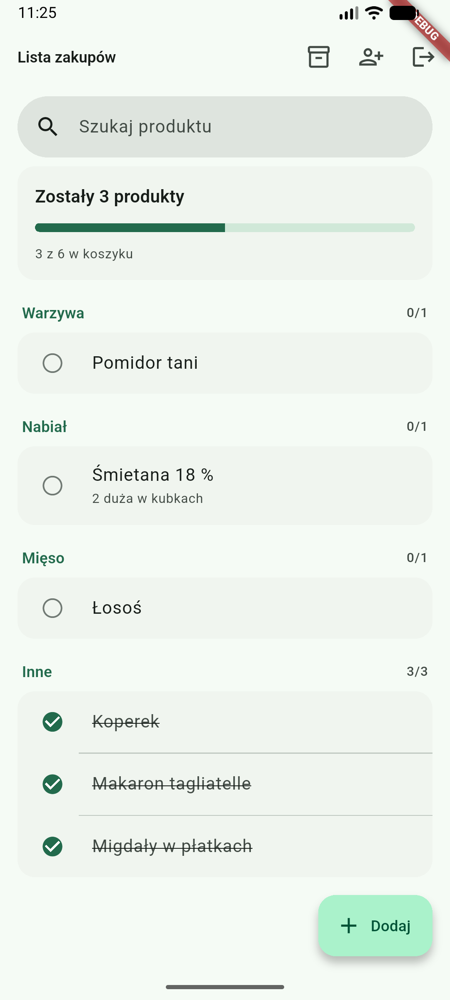
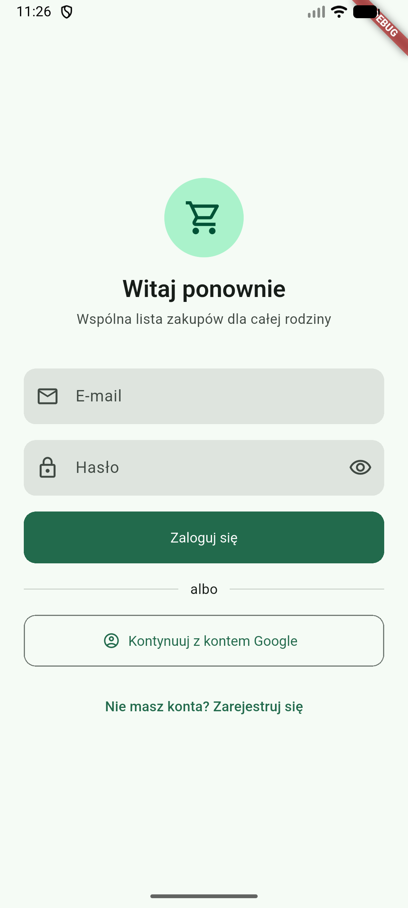
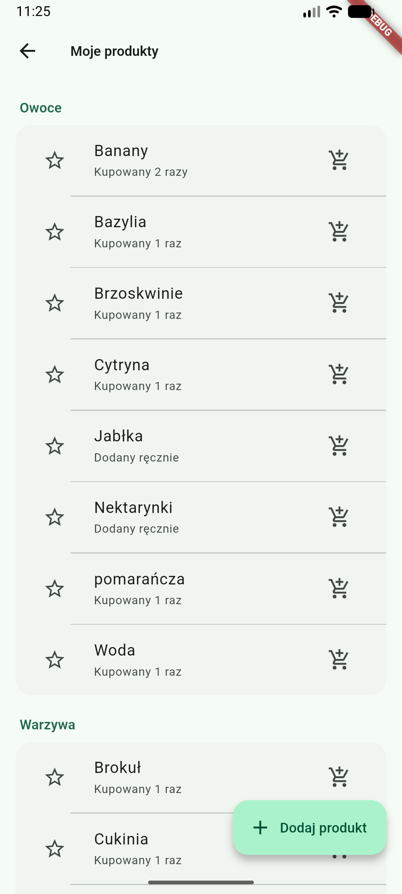
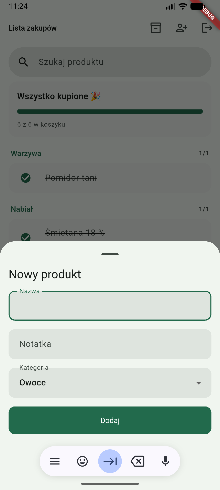

# 🛒 Shopping List — shared grocery list for households

A real-time, shared grocery list built with **Flutter** and **Firebase**, designed for couples and
families who shop together. Changes made on one phone appear on the other within a second.

The project was built from scratch as a hands-on way to learn Dart and Flutter, with a strong focus
on **Clean Architecture**, testable business logic and thoughtful handling of real-world edge cases.

**🔗 Live demo:** https://shoppinglist-c20c5.web.app

<p align="center">
  
  
  
  
</p>


---

## ✨ Features

- **Shared households** — create a household and invite others with a short, human-friendly invite
  code (no ambiguous characters like `0/O` or `1/I`)
- **Real-time sync** — every change is instantly visible to all household members (Cloud Firestore
  snapshots)
- **Offline support** — changes are saved locally and synced when the connection is back
- **Authentication** — email & password or Google Sign-In
- **Categories in store-aisle order** — items are grouped into sections (fruit, vegetables,
  dairy, …) in a fixed, predictable order
- **Smart suggestions** — the app learns from your shopping history; frequently bought and pinned
  products appear as one-tap chips when adding items
- **Product catalog** — manage remembered products manually: add, edit, pin ⭐, remove or add to the
  list in one tap
- **Search** — filters by product name and notes
- **Bought items sink to the bottom** of each section, with a progress summary at the top
- **Notes** per item (e.g. "lactose-free", "2 packs")
- **Polish pluralisation** ("1 produkt", "3 produkty", "5 produktów")
- **Graceful error handling** — clear error screens with a retry button instead of infinite spinners
- **Auto-refresh on resume** — reconnects data listeners when the app returns from the background
  (important for iOS web apps)
- **Pull-to-refresh**
- **Material 3 design** with light & dark mode generated from a single seed colour

---

## 🏗️ Architecture

The app follows **Clean Architecture** with a **feature-first** folder structure. Each feature is
split into three layers:

```
┌──────────────────┐      ┌────────────────────────┐      ┌───────────────────┐
│   presentation   │ ───▶ │         domain         │ ◀─── │       data        │
│                  │      │                        │      │                   │
│ Widgets, Cubits, │      │ Entities, use cases,   │      │ Firebase repos,   │
│ UI state         │      │ repository interfaces, │      │ mappers           │
│                  │      │ domain failures        │      │                   │
└──────────────────┘      └────────────────────────┘      └───────────────────┘
```

- **Domain** is pure Dart — no Flutter, no Firebase. It contains entities, business rules (use
  cases), repository *interfaces* and domain-specific failures.
- **Data** implements the repository interfaces (dependency inversion). It is the only layer that
  knows about Firestore and Firebase Auth, and it translates Firebase exceptions into domain
  failures.
- **Presentation** uses **Cubits** (`flutter_bloc`) for screen state. Widgets are kept "dumb" and
  communicate through callbacks.
- **Dependency injection** is handled by `get_it` in a single composition root
  (`core/di/injection.dart`). Swapping the in-memory repository for the Firebase one required
  changing **one line**.

### Project structure

```
lib/
├── core/
│   ├── data/            # shared data-layer helpers (Firestore error mapping)
│   ├── di/              # dependency injection (composition root)
│   ├── failures/        # shared domain failures
│   ├── theme/           # Material 3 theme (light & dark)
│   ├── utils/           # e.g. Polish pluralisation
│   └── widgets/         # reusable widgets (empty state, error banner, refresh on resume)
├── features/
│   ├── auth/            # sign in / sign up / Google Sign-In, session state
│   ├── household/       # creating & joining households, invite codes
│   └── shopping_list/   # shopping list, product catalog, suggestions
│       ├── domain/
│       │   ├── entities/
│       │   ├── repositories/
│       │   └── usecases/
│       ├── data/
│       │   ├── mappers/
│       │   └── repositories/
│       └── presentation/
│           ├── cubit/
│           ├── pages/
│           └── widgets/
├── firebase_options.dart
└── main.dart
```

### Navigation flow

```
AuthGate
├── unknown           → loading
├── unauthenticated   → LoginPage
└── authenticated     → HouseholdGate
                         ├── unknown          → loading
                         ├── missing          → HouseholdSetupPage (create / join)
                         ├── error            → error screen with retry
                         └── ready(id)        → ShoppingListPage
                                                 └── push → CatalogPage
```

Session and household states are modelled as **sealed classes**, so the compiler enforces that every
state is handled — adding a new state immediately highlights every place that needs updating.

---

## 🗄️ Data model (Cloud Firestore)

```
users/{uid}
  householdId: "K7P3XM"

households/{householdId}            ← document ID is the invite code
  memberIds: [uid1, uid2]
  createdAt: timestamp

  items/{itemId}                    ← shopping list
    name, category, isBought, note, createdAt

  catalog/{normalizedName}          ← remembered products (e.g. "mleko")
    name, category, useCount, isPinned, lastUsedAt
```

### Security rules

Access is enforced on the server, not in the app:

- users can read and write **only their own** user document,
- a household can be read by ID (needed to join), but households **cannot be listed**, so invite
  codes can't be enumerated,
- a user can only create a household where they are the **sole member**, and can only modify
  `memberIds` by **adding themselves**,
- items and catalog entries are accessible **only to members** of the household.

---

## 💡 Interesting problems solved

**Upserting catalog entries without reads.**
Catalog documents use the normalized product name as their ID (`" Mleko "` → `mleko`). Adding an
item to the list performs a single `set(..., merge: true)` with `FieldValue.increment(1)` — no prior
read, safe under concurrent writes from both household members. Renaming a product moves the
document in an atomic batch, preserving its usage count.

**A race condition caused by Firestore latency compensation.**
After creating a household, the local write to `users/{uid}` was delivered to listeners *before* the
server confirmed the batch. The list then queried `households/{id}/items` while the household
document didn't exist on the server yet, the security rule rejected it, and Firestore permanently
closed the listener. Fixed by listening with `includeMetadataChanges: true` and ignoring snapshots
with `hasPendingWrites`.

**One use case coordinating two repositories.**
`AddShoppingItem` writes the item to the list **and** records usage in the catalog (in parallel via
`Future.wait`). Because this rule lives in the domain, items added from any screen — the add sheet,
a suggestion chip or the catalog — are always counted.

**Stream error handling.**
Firestore stream errors are translated into domain failures with a generic `Stream<T>` extension
(`mapFirestoreErrors`). Cubits catch them via `onError`, expose them in state and offer a retry that
re-subscribes (Firestore does not resume a closed listener on its own). Non-critical streams
(suggestions) fail silently so they never block the main screen.

**Derived state instead of duplicated state.**
Search results, grouped sections, counters and suggestions are computed via getters on the state
object rather than stored, so they can never get out of sync with the source data.

---

## 🧰 Tech stack

| Area                 | Technology                                                            |
|----------------------|-----------------------------------------------------------------------|
| UI                   | Flutter, Material 3                                                   |
| Language             | Dart 3 (sealed classes, records, pattern matching, extension methods) |
| State management     | `flutter_bloc` (Cubit), `equatable`                                   |
| Dependency injection | `get_it`                                                              |
| Backend              | Firebase Auth, Cloud Firestore                                        |
| Hosting              | Firebase Hosting (web / installable on iPhone home screen)            |

---

## 🚀 Getting started

### Prerequisites

- [Flutter SDK](https://docs.flutter.dev/get-started/install)
- A [Firebase](https://console.firebase.google.com) project with **Authentication** (Email/Password
  and Google) and **Cloud Firestore** enabled
- [Firebase CLI](https://firebase.google.com/docs/cli)
  and [FlutterFire CLI](https://firebase.google.com/docs/flutter/setup)

### Setup

```bash
git clone https://github.com/your-username/shopping_list.git
cd shopping_list
flutter pub get

# connect the app to your own Firebase project
flutterfire configure --platforms=android,web
```

Copy the security rules described above into **Firestore → Rules** in the Firebase console.

### Run

```bash
flutter run -d chrome      # web
flutter run                # Android emulator / device
```

### Deploy (web)

```bash
flutter build web --release
firebase deploy --only hosting
```

On iPhone, open the hosted URL in Safari and choose **Share → Add to Home Screen**.

---

## 🗺️ Roadmap

- [ ] Unit tests for use cases and Cubits
- [ ] Deposit-return voucher wallet (scan and store barcodes from bottle-return machines)
- [ ] Native iOS build distributed via TestFlight
- [ ] "Finish shopping" with purchase history